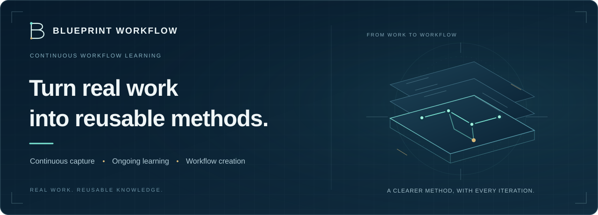
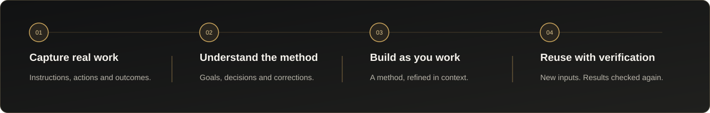

<p align="center">
  <a href="README.md">繁體中文</a> &nbsp; / &nbsp; <strong>English</strong>
</p>

<p align="center">
  
</p>

<p align="center">
  <strong>Keep working with your AI. Build the method as you go.</strong><br>
  Capture key steps, preserve decisions and corrections, and develop work assets you can verify, deliver and reuse.
</p>

<p align="center">
  
  
  
</p>

<p align="center">
  <a href="#product-value">Product value</a> ·
  <a href="docs/installation.en.md">Installation</a> ·
  <a href="docs/validation.en.md">Validation</a> ·
  <a href="docs/service.en.md">Service plans</a>
</p>

---

## Product value

**Blueprint Workflow** is a workflow-learning plugin for existing AI agents. As you work, it develops a reusable method from your goals, instructions, observed results and corrections—preserving the experience that makes a process useful beyond a single task.

For professionals and teams, the asset includes both the final output and the method behind it. Blueprint Workflow connects how the work was completed with the decisions that shaped it, reducing the effort of reconstructing the process later.

| Traceable work | An evolving method | Human-directed improvement |
| :--- | :--- | :--- |
| Connect goals, decisions, results and corrections to actual evidence. | Maintain a workflow draft across multiple stages and work periods. | Review findings prompted by fundamental issues, recurring failures or evidence of a better approach. |

## How it works

<p align="center">
  
</p>

1. **Define the outcome and completion criteria** — Start a new workflow in your existing AI conversation.
2. **Continue directing the agent, checking outputs and making corrections** — Key steps are retained while the background process develops the method.
3. **Refine at meaningful moments** — Review evidence-based findings and alternatives. Confirmed changes become part of the working method.
4. **Finalize, deliver and verify reuse with new inputs** — Preserve a fixed version and related materials, with separate progress and result checks for each execution.

Each new task starts with its own requirements. Tools, routes, sequence and completion criteria come from that task's instructions and actual work. Workflow design continues in its original conversation and can recover after an application restart or context compaction.

## Preserve the method as a working asset

| Asset | What is retained |
| --- | --- |
| **A reusable method** | Steps, dependencies, variable inputs, outputs and completion criteria. |
| **Source-linked decisions** | Instructions, corrections, approvals, rejections, deferrals and their supporting references. |
| **Related artifact versions** | Explicitly registered input, reference and output versions, with hashes and source references. |
| **Checkable execution records** | Each run's progress, actual results, unresolved items and verification state. |

Task records are stored in a private local data directory; AI inference uses the selected engine. The foreground agent continues the work while background processing handles understanding, workflow creation and research when needed. Suggestions explain their basis and tradeoffs, and user decisions are retained.

## Work within your AI environment

Local adapters are provided for **Codex, Claude Code, Cursor and Gemini CLI**. The foreground host and background analysis engine are configured independently, using the selected CLI's existing login.

Cursor requires an explicitly selected supported background engine. Native authentication, hooks and research capabilities are distinguished by environment and actual validation. See [Installation](docs/installation.en.md) and [Validation](docs/validation.en.md).

### Start after receiving an installation package

Open PowerShell in the root of the separately provided package. For Codex:

```powershell
python --version   # Python 3.12 or later is required
& .\scripts\install-local.ps1 -Host codex
```

After installation and activation, tell your agent:

> Use Blueprint Workflow to record this task and develop a reusable workflow as we work. The goal is … The completion criteria are …

**This is a public product-information repository. Application source and installation packages are not included.** The commands above apply to the separately supplied package. Read the [installation guide](docs/installation.en.md) for full prerequisites and other host commands.

## For people who build working methods

Designed for professionals, operations teams, consultants and AI workflow designers who need to develop processes with AI, preserve specialist decisions and deliver reusable ways of working.

## Monthly service in planning

Blueprint Studio is planning a monthly service offering for Blueprint Workflow. The formal offering will define access and installation arrangements, updates, support scope and pricing.

This repository currently provides product information and usage guidance. Service plans and availability will be announced separately. [Explore the service direction →](docs/service.en.md)

## Development validation

| 198 tests | 10,000 records | 30 tools |
| :---: | :---: | :---: |
| Passed for product version 0.3.0 | Synthetic records across fourteen simulated work periods | Verified MCP tool interfaces |

Real background-model analysis, read-only research, new-input execution through the current host and a separately extracted package process were also exercised. Test conditions, verified capabilities and outstanding checks are documented in [Validation](docs/validation.en.md).

---

<p align="center">
  <strong>Blueprint Workflow · 藍圖工作流</strong><br>
  Developed by Blueprint Studio · 藍圖工作室<br>
  <a href="README.md">繁體中文</a> · <a href="docs/installation.en.md">Installation</a> · <a href="docs/service.en.md">Service information</a>
</p>
