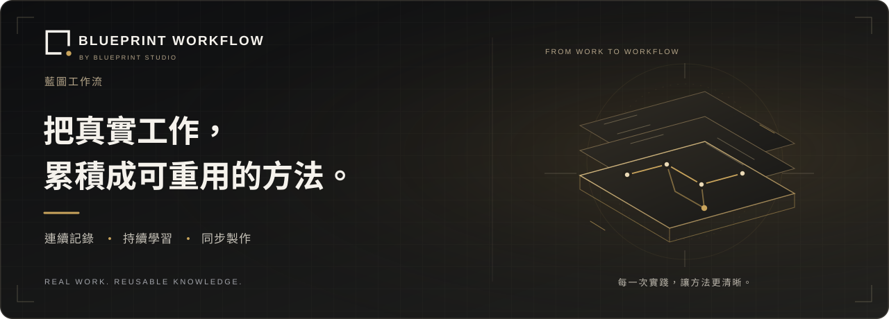
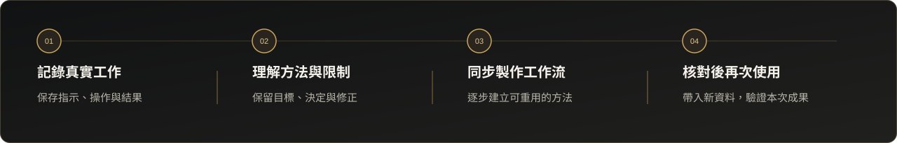

<p align="center">
  <strong>繁體中文</strong> &nbsp; / &nbsp; <a href="README.en.md">English</a>
</p>

<p align="center">
  
</p>

<p align="center">
  <strong>與熟悉的 AI 繼續工作，讓方法同步形成。</strong><br>
  記錄關鍵步驟，保留判斷與修正，建立可驗證、可交付、可重用的工作資產。
</p>

<p align="center">
  
  
  
</p>

<p align="center">
  <a href="#產品價值">產品價值</a> ·
  <a href="docs/installation.zh-Hant.md">安裝指引</a> ·
  <a href="docs/validation.zh-Hant.md">驗證狀態</a> ·
  <a href="docs/service.zh-Hant.md">服務方向</a>
</p>

---

## 產品價值

**藍圖工作流（Blueprint Workflow）** 是融入既有 AI Agent 的工作流學習外掛。在工作進行期間，它持續整理目標、指示、操作結果與修正，將一次任務中形成的經驗，逐步建立成可以接續、交接與重用的方法。

對專業人士與團隊而言，有價值的不只是最後成品，還包括「如何完成」以及「為何這樣做」。藍圖工作流把這些脈絡連結起來，減少日後重建方法的負擔。

| 工作可追溯 | 方法同步形成 | 改善由你決定 |
| :--- | :--- | :--- |
| 將目標、決定、結果與修正連結到實際依據。 | 在多階段、跨多日的工作中持續更新流程草稿。 | 在本質問題、反覆失敗或有根據的改善機會出現時提出建議。 |

## 如何工作

<p align="center">
  
</p>

1. **說明目標與完成標準** — 在原有 AI 對話中啟動一個新工作流。
2. **照常指示 AI、檢查成果與提出修正** — 關鍵步驟持續保存，背景同步整理方法。
3. **在重要節點改善方法** — 檢視有依據的問題與替代方案；經你確認的變更，才成為正式方法的一部分。
4. **定稿、交付，再以新輸入驗證重用** — 保存固定版本與相關資料，每次執行分開記錄進度及成果。

每個新工作都由自身的需求開始。工具、路線、次序及完成標準，來自當次指示與實際工作。工作流設計固定在原本對話中接續，支援程式重啟及對話壓縮後恢復。

## 把方法保留成工作資產

| 工作資產 | 保留內容 |
| --- | --- |
| **可重用的方法** | 步驟、依賴關係、可變輸入、輸出與完成條件。 |
| **有依據的決定** | 指示、糾正、採納、拒絕、延後及相關來源。 |
| **相關檔案版本** | 明確登記的輸入、參考資料與產物版本，連同雜湊及來源引用。 |
| **可核對的執行紀錄** | 每次重用的進度、實際結果、未解事項及驗收狀態。 |

工作記錄保存在本機私人資料目錄；AI 推理使用所選引擎。前台繼續完成工作，背景負責理解、製作與按需研究。改善建議會說明依據及取捨，使用者的決定持續保留。

## 沿用你的 AI 工作環境

提供 **Codex、Claude Code、Cursor 及 Gemini CLI** 的本機接駁設計。前台宿主與背景分析引擎分開配置，沿用所選 CLI 的既有登入。

Cursor 需明確選擇受支援的背景引擎。各宿主的原生登入、Hooks 與研究能力按環境及實測範圍區分，詳見[安裝指引](docs/installation.zh-Hant.md)及[驗證狀態](docs/validation.zh-Hant.md)。

### 取得安裝套件後開始

在另外獲提供的安裝套件根目錄開啟 PowerShell，以 Codex 為例：

```powershell
python --version   # 需要 Python 3.12 或以上
& .\scripts\install-local.ps1 -Host codex
```

安裝並啟用後，在 AI 對話輸入：

> 使用藍圖工作流記錄今次任務，一邊工作一邊整理可重用流程。目標是……完成標準是……

**本倉庫是公開產品介紹頁，沒有程式碼或安裝套件。** 上述指令適用於另外提供的安裝套件；完整環境要求及其他宿主命令，請閱讀[中英文安裝文件](docs/installation.zh-Hant.md)。

## 為建立工作方法的人而設

適合需要與 AI 共同設計工作、保留專業判斷，以及交付可重用流程的專業人士、營運團隊、顧問與 AI 工作流設計者。

## 月費服務規劃中

藍圖工作室正規劃以月費形式提供藍圖工作流服務。正式方案將說明取得與安裝安排、更新方式、支援範圍及收費。

目前本倉庫提供產品資訊與使用指南；服務方案及正式供應安排將另行公布。[了解服務方向 →](docs/service.zh-Hant.md)

## 開發驗證

| 198 項 | 10,000 筆 | 30 個 |
| :---: | :---: | :---: |
| 0.3.0 程式測試通過 | 合成記錄與十四個模擬工作日 | 已核對的 MCP 工具介面 |

另完成真實背景模型分析、唯讀研究、目前宿主的新輸入重用，以及獨立安裝包的程序啟動驗證。測試條件、已驗證能力及待驗證項目，集中記錄於[驗證狀態](docs/validation.zh-Hant.md)。

---

<p align="center">
  <strong>Blueprint Workflow · 藍圖工作流</strong><br>
  由 Blueprint Studio · 藍圖工作室開發<br>
  <a href="README.en.md">English</a> · <a href="docs/installation.zh-Hant.md">安裝文件</a> · <a href="docs/service.zh-Hant.md">服務資訊</a>
</p>
